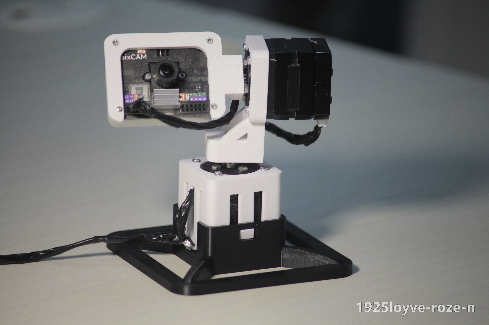
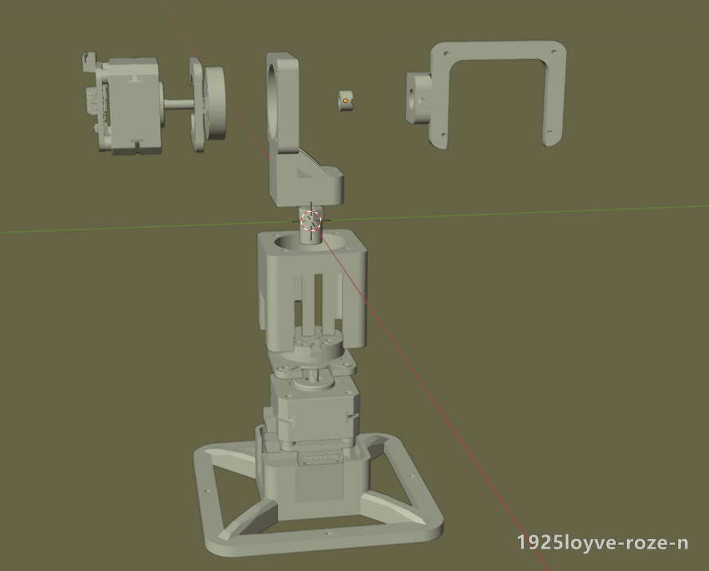
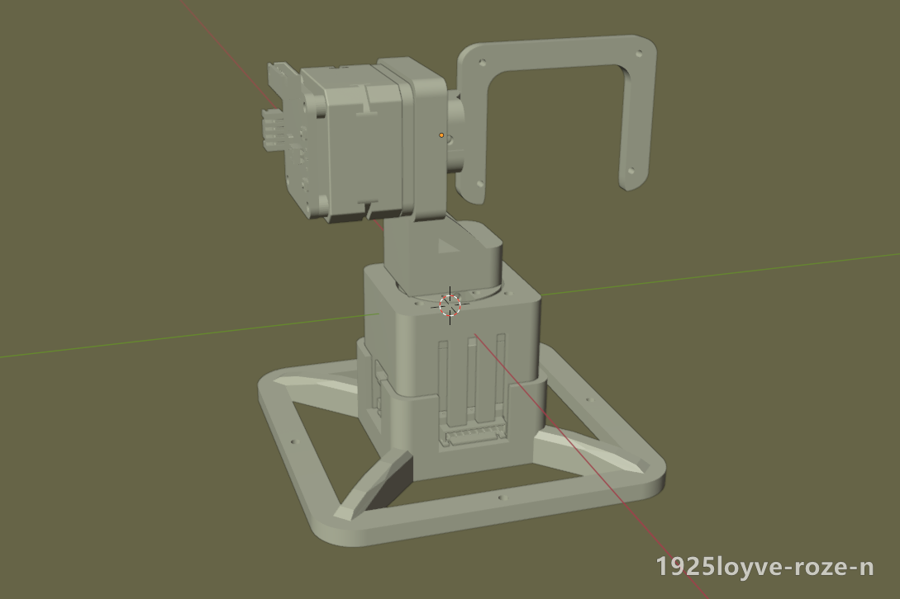
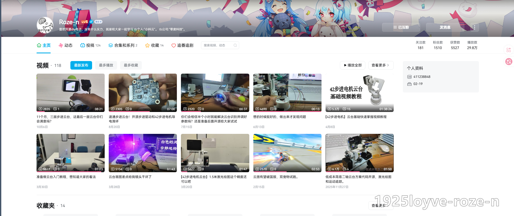
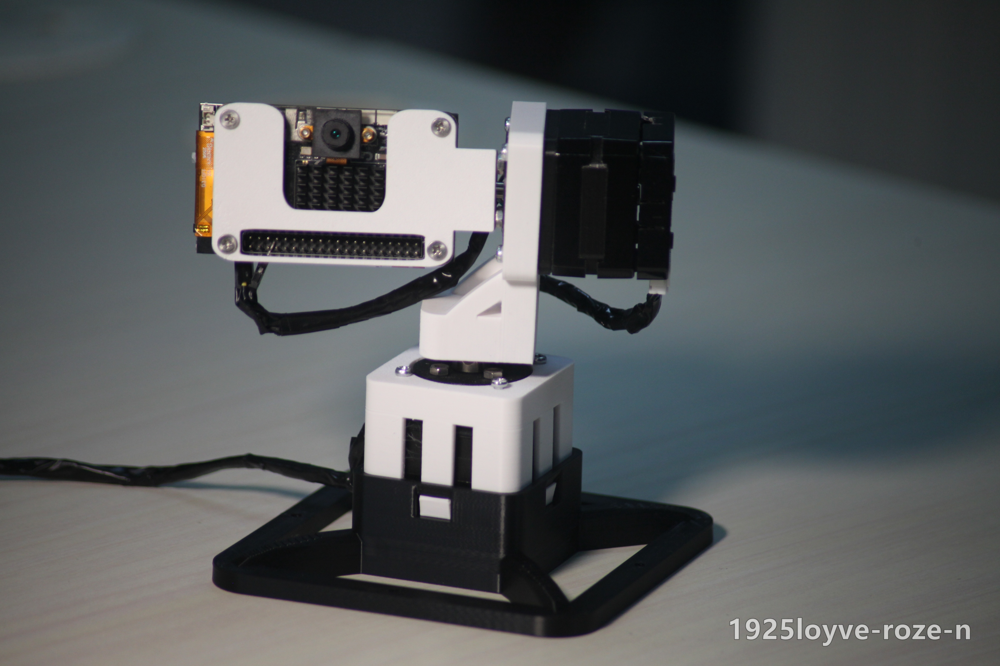
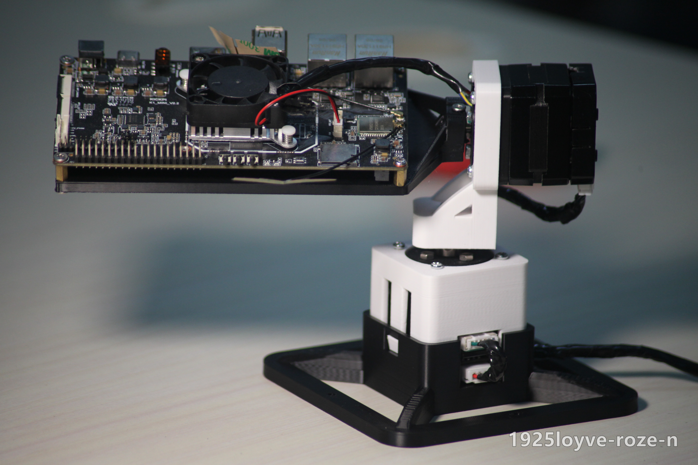
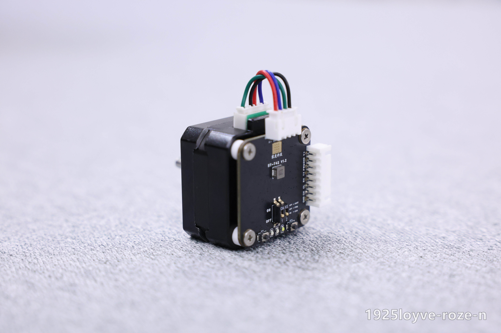
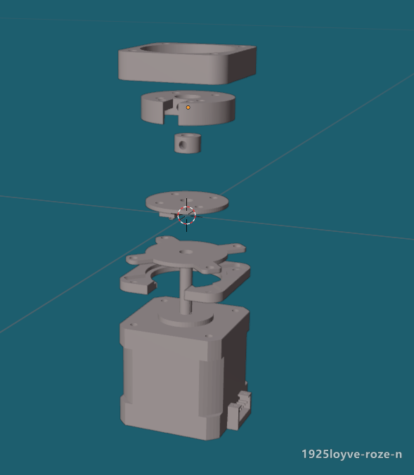

# 42步进电机双轴云台

**42 Stepper Motor Pan-Tilt Gimbal**

一个基于42步进电机的双轴视觉云台，适用于DIY电子制作、大学生电子设计竞赛、机器人开发、视觉追踪及各种创意项目。

项目提供3D打印模型、机械结构资料以及相关硬件开源链接。你可以直接复刻一套云台，也可以根据自己的需求修改结构、搭载不同的视觉模块。

### 许可与使用声明

**除另有说明外，本仓库中由本项目作者原创并有权授权的云台模型、机械设计资料、图片及说明文档，采用 [CC BY-NC-SA 4.0（署名—非商业性使用—相同方式共享 4.0 国际版）](./LICENSE)许可。**

欢迎学习、研究、非商业DIY复刻、修改及分享，请遵守以下要求：

- **署名（BY）**：分享时保留原作者署名、版权及许可声明，提供原项目和许可证链接，并标明是否进行了修改。
- **非商业性使用（NC）**：本许可不授予商业使用权限；商业用途需事先取得作者的单独授权。
- **相同方式共享（SA）**：对外分享基于这些资料形成的改编作品时，须按 CC BY-NC-SA 4.0 或该协议允许的兼容许可发布。仅修改自用不要求公开。

**未经单独商业授权，不得将上述受许可资料或其改编作品用于商业目的。** 例如出售模型文件、复制本项目图片或说明用于商品推广，或利用本项目模型进行以销售为目的的打印、生产及套件制作。无论直接使用原模型，还是修改后使用，都不会因此自动获得商业授权。

非商业性取决于使用目的，不仅取决于使用者是个人还是机构。商业使用或合作可通过 [B站私信](https://space.bilibili.com/411238848)联系作者；具体授权范围以另行达成的商业许可为准。

**许可范围仅限本仓库中适用上述声明的资料。** [ST42驱动板及固件](https://github.com/1925loyve/Step42-ClosedLoop-Stepper-Drive)、[导电滑环](https://github.com/1925loyve/42-slip-ring)等独立项目，以及另有许可声明的第三方资料，均遵循各自的许可证；本声明不更改这些项目已经授予的权利。

本项目采用含非商业限制的公开许可，不属于允许自由商用的开源硬件许可。以上为便于理解的说明，不增加或改写标准协议条款；完整条款见 [LICENSE](./LICENSE)，也可查看[官方中文摘要](https://creativecommons.org/licenses/by-nc-sa/4.0/deed.zh-hans)。本许可仅涉及作者有权许可的著作权及相关权利，不限制依法无须许可的使用，也不授予专利或商标权。

---

## 云台展示

### 主页空间与视频链接(点击直达)

<!--

-->
---

## 云台可以做什么？

本云台采用两个42系列步进电机，分别控制Yaw水平旋转和Pitch俯仰旋转。

支持搭载MaixCAM Pro、K230等视觉模块，适合进行视觉算法和机器人控制开发。

**视觉追踪**

通过视觉模块识别目标位置，结合步进电机运动控制，实现人脸跟随、物体追踪和目标居中等功能。

**机器人视觉平台**

可以作为桌面视觉装置，也可以安装到移动机器人、小车或其他DIY机器人上，为机器人提供可转动的视觉观察机构。

**运动控制学习**

适合学习步进电机控制、速度与加速度规划、双轴联动及嵌入式开发。

**机械设计与二次开发**

提供3D打印结构，可自行修改摄像头安装座、底部固定结构，并适配其他传感器或视觉模块。

**搭载K230的云台**

**搭载rk3568的云台**

---

## 硬件介绍

云台主体采用ABS材料3D打印，使用两个42系列、23mm机身、1.8°步距角的步进电机。

两个旋转轴分别配置6路导电滑环，用于旋转过程中的信号和供电传输，减少线束缠绕。

机械结构采用紧凑设计，通过金属连接件固定电机轴与云台支架，尽量减少视觉模块的悬臂距离。

项目已提供MaixCAM Pro和K230适配底座，也可以根据现有模型自行修改其他视觉模块的安装结构。

| 项目 | 配置 |
| --- | --- |
| 云台结构 | 双轴Yaw/Pitch |
| 电机 | 42系列23mm两相步进电机 |
| 步距角 | 1.8° |
| 机械材料 | ABS 3D打印 |
| 导电滑环 | 双轴6路导电滑环 |
| 配套驱动板 | ST42 V1.2 |
| 视觉模块 | MaixCAM Pro、K230等 |
| 安装方式 | 可拆卸桌面底座及自定义安装 |

注意：具体旋转范围、负载能力和控制效果与装配结构、驱动器及控制参数有关。

---

## 项目资料与快速复刻

本项目由机械结构、步进驱动板和导电滑环组成，相关资料分别放在对应仓库中。

### 1. ST42 V1.2步进驱动板

[ST42 v1.2步进驱动板开源地址](https://github.com/1925loyve/Step42-ClosedLoop-Stepper-Drive)

包含配套驱动板的硬件和固件资料。

建议直接下载生产文件进行PCB打样，并选择SMT贴片服务完成焊接。制作完成后，按照对应仓库说明烧录匹配的固件。

### 2. 42步进电机导电滑环

[导电滑环开源地址](https://github.com/1925loyve/42-slip-ring)

本云台采用两个6路导电滑环，分别安装在上下两个旋转轴。

滑环设计、制作资料及相关说明可以在该仓库查看。

### 3. 云台3D打印模型

[查看本项目STL模型目录](./models/)

包含云台主体、桌面底座和视觉模块适配结构。

目前提供MaixCAM Pro与K230相关安装模型，其他模块可根据实际孔位自行修改。

### 4. 简单复刻流程

1. 下载ST42驱动板资料，完成PCB打样、SMT贴片及固件烧录。
2. 根据导电滑环仓库制作或准备两个导电滑环。
3. 下载本项目STL模型，完成3D打印，并根据BOM购买电机、金属件和螺丝。
4. 将驱动板、滑环、电机和打印件装配成完整云台，检查接线后进行双轴运动测试。
5. 根据需要安装MaixCAM Pro或K230，配置视觉识别和运动控制程序。

建议先完成基础运动功能，再增加视觉追踪。

---

## 成品与配件

如果你不方便自行3D打印、PCB打样或者购买零件，也可以选择现成的机械结构或相关配件。
本项目作者同时提供云台整体，以及导电滑环和驱动板的成品，方便DIY爱好者的快速上手，可以自己动手搭配。

**淘宝店铺：**【暂无】

**可选产品：**【暂无】

购买前请注意不同套餐所包含的电机、导电滑环、驱动板和视觉模块可能不同，具体以商品详情为准。

---

## Q&A 常见问题

**Q1：云台一定要使用ST42 V1.2驱动板吗？**

不一定。你可以使用其他能够驱动对应步进电机的控制板，但需要自行适配电气接口、安装结构和控制程序。

**Q2：是否必须使用MaixCAM Pro？**

不需要。本项目也提供K230的安装结构。其他视觉模块可以通过修改3D模型进行适配。

**Q3：为什么选择23mm机身的42步进电机？**

主要考虑整体体积、成本和结构紧凑性，适合轻量化视觉模块及DIY项目。使用较重模块时，需要注意转矩、转动惯量和结构负载。

**Q4：安装导电滑环后，可以无限旋转吗？**

导电滑环能够减少旋转造成的线束缠绕，但需要避免高速旋转（超过300rpm）下的通信，可能会出现数据丢失，整机实际旋转范围还受到机械结构和其他接线限制，需要根据装配情况确认。

**Q5：我可以修改模型制作自己的云台吗？**

可以。欢迎在 CC BY-NC-SA 4.0 许可下进行非商业学习、DIY制作和二次开发。分享模型或改编作品时，请保留署名、注明修改，并遵守相同方式共享要求；仅修改自用无需公开。修改时请注意机械强度、重心分布和电气安全。

**Q6：可以直接用模型生产出售，或修改后上架销售吗？**

本项目的 CC BY-NC-SA 4.0 许可不授予这类商业使用权限，无论是否修改、是否批量生产，都需要另行取得作者的商业授权。修改模型并不会自动解除非商业限制。关联的驱动板、固件和导电滑环仍按各自仓库的许可证执行。

**Q7：如果复刻时遇到问题怎么办？**

可以通过b站私信，也可以通过GitHub Issues反馈问题，建议附上使用的硬件版本、照片及问题描述，方便排查。

---

感谢关注这个项目！欢迎分享你的DIY作品，也欢迎提出改进建议。
